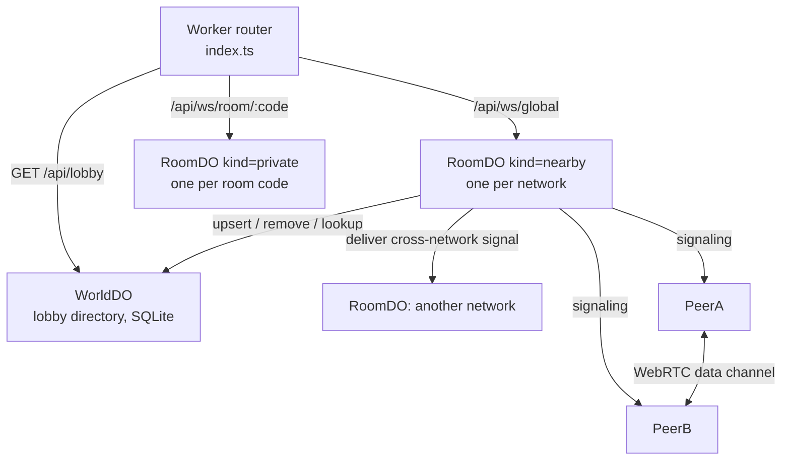
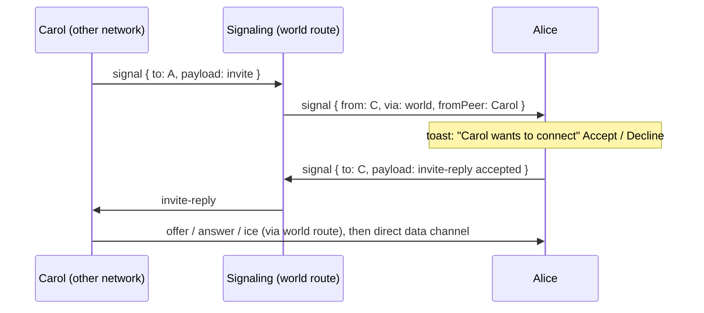
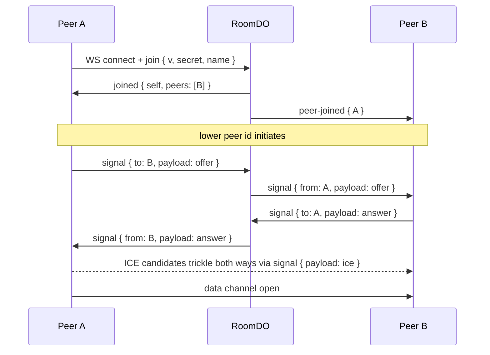
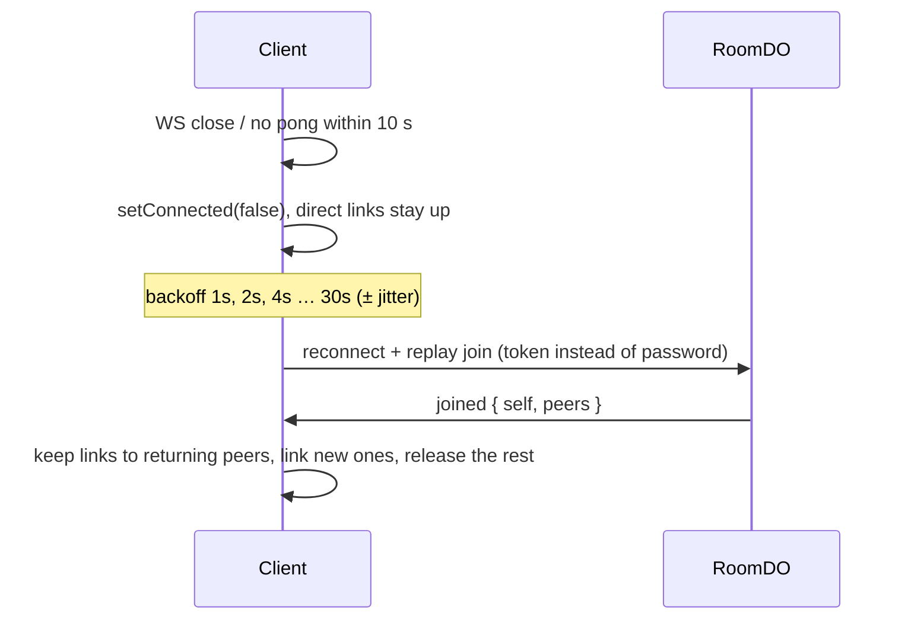
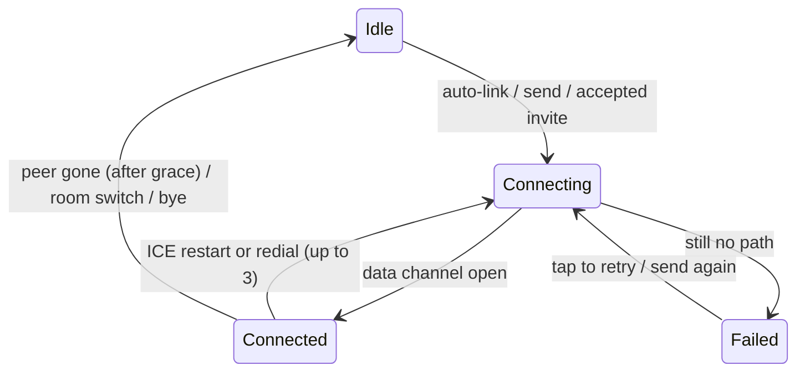
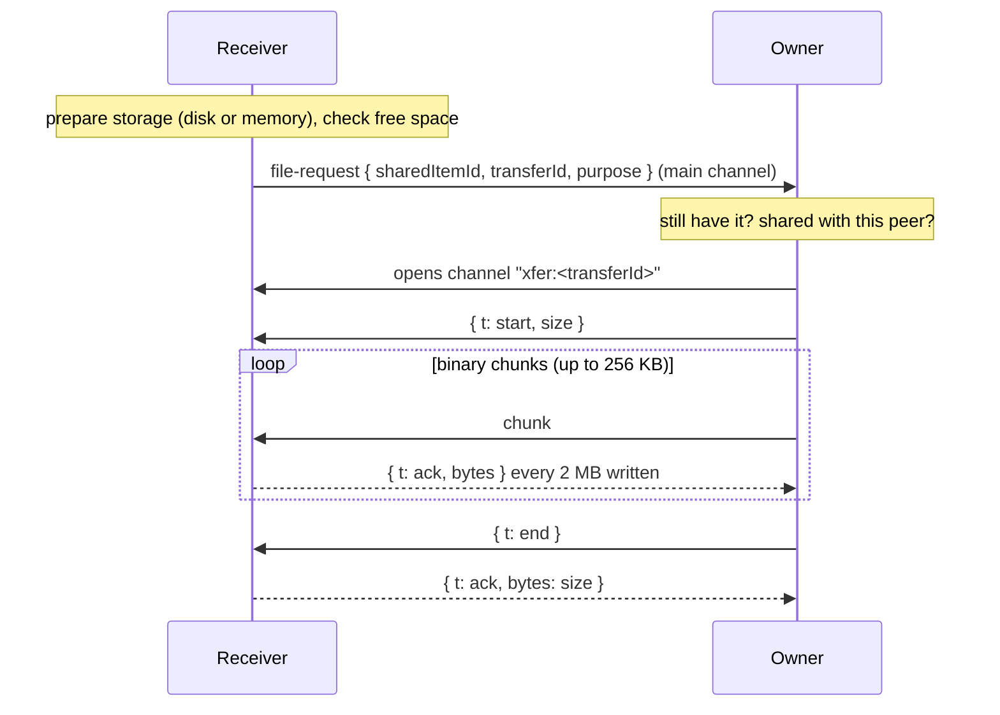

# ZeroRelay Architecture

## Overview

ZeroRelay is a P2P opensource mesh app for sharing files and text directly between browsers. No central database. Each peer owns its own copy of data in IndexedDB (Dexie). The signaling server (Cloudflare Worker + Durable Objects) only helps peers find each other and exchange WebRTC SDP/ICE. Data flows directly browser-to-browser over WebRTC data channels.



## Stack

| Layer | Technology |
|---|---|
| Frontend | Next.js 15 (App Router) |
| State | Zustand |
| Persistence | Dexie v4 (IndexedDB) |
| P2P | WebRTC (mesh, trickle ICE, STUN) |
| Signaling | Cloudflare Workers + Durable Objects (WebSocket Hibernation API) |
| Styling | Tailwind CSS v4 |

## Code map

| Path | Role |
|---|---|
| `shared/types.ts` | Wire protocol (client ↔ worker), limits, `PROTOCOL_VERSION`, `derivePeerId` |
| `shared/sha256.ts` | Sync SHA-256 used by both sides (`crypto.subtle` is missing on plain-http LAN) |
| `workers/signaling/src/index.ts` | Router: computes the caller's network key, forwards to the right Durable Object |
| `workers/signaling/src/room-do.ts` | `RoomDO`: presence, auth, signal relay, heartbeat sweep, room expiry |
| `workers/signaling/src/world-do.ts` | `WorldDO`: lobby directory (who is visible on other networks) |
| `workers/signaling/src/net.ts` | IP → network group (IPv4 address, IPv6 /64, private ranges → dev group) |
| `workers/signaling/src/auth.ts` | PBKDF2 password hashes, HMAC join tokens, constant-time compare |
| `workers/signaling/src/validate.ts` | Runtime validation of every client frame |
| `src/lib/identity.ts` | Our secret + derived peer id (localStorage) |
| `src/lib/signaling.ts` | `SignalingClient`: one socket, backoff + jitter, heartbeat, join replay |
| `src/hooks/use-signaling.ts` | Join/leave/delete/rename/visibility; maps server messages into stores |
| `src/lib/peer-mesh.ts` | `PeerMesh`: every WebRTC link of this device. Offers, glare, ICE restart, redials, wait-for-open, extra channels |
| `src/lib/peer-protocol.ts` | Runtime validation of every message another peer sends |
| `src/lib/transfer/` | File transfer: `manager` (requests, authorization, state), `stream` (binary send/receive with flow control), `sinks` (disk or memory), `save` |
| `src/lib/avatar.ts` | Shrinks a picked image to a 128px avatar |
| `src/lib/world-links.ts` | `WorldLinks`: invite / accept / decline / bye with people on other networks |
| `src/hooks/use-mesh.ts` | Creates the mesh once and keeps it in step with the room (who to link, leave grace, wake) |
| `src/hooks/use-room.ts` | Glue: signaling ↔ mesh, sharing, file transfer, avatars |
| `src/hooks/use-visible-peers.ts` | UI view of peers: room members + accepted lobby links, with link state |
| `src/components/lobby/` | Lobby dialog ("Everyone") and invite toasts |
| `src/lib/endpoints.ts` / `src/lib/lobby.ts` | Worker URLs; lobby HTTP client |

## Rooms

### Global (Nearby)

`/api/ws/global` is routed to the Durable Object named `net:<netKey>`, where
`netKey = sha256(IP_SALT | networkGroup(CF-Connecting-IP))`. Everyone behind the same public IP (same router) lands in the same object; nobody else can. Nothing about a Nearby room is persisted.

`networkGroup` is the IPv4 address, or the /64 prefix for IPv6. Private, loopback, ULA and link-local addresses all map to one `dev-lan` group so local development and self-hosting on a LAN work.

### Everyone (world lobby)

Peers in a Nearby room with `visibility: "world"` (the default, toggle in the profile dialog) are registered in the single `WorldDO` directory: `{id, name, netKey, seen}`. Each Nearby room refreshes its entries on every heartbeat sweep (30 s); entries not refreshed for 3 min are pruned.

- `GET /api/lobby?q=&cursor=` returns `{ total, peers: [{id, name}], next }`, excluding the caller's own network. Never includes network info.
- A `signal` to a peer that isn't in the sender's room is routed: `WorldDO.lookup(to)` → network key → that network's `RoomDO.deliver()`. Only lobby-visible Nearby peers can send or receive these, at most 120 per minute per peer. The receiver gets `via: "world"` plus the sender's `{id, name}`.

#### Consent flow

Nothing is exchanged with a lobby peer, not even WebRTC candidates (which reveal IP addresses), until both sides agree:



- Offers, answers and candidates arriving `via: "world"` are dropped unless the link is accepted.
- Declining mutes that person's invites for 10 minutes. Unanswered invites expire after 60 s.
- Either side can end the link (`bye`). Links are dropped when you leave the Global room.
- Accepted lobby links appear on the radar as "other network" and can be picked as recipients. "Everyone" sends still go to room members only.
- There is no relay: if the two networks block direct connections, both sides see "Couldn't connect directly".

### Private rooms

`/api/ws/room/:code` → Durable Object `room:<code>`. Codes are 12 random characters from an unambiguous alphabet (`generateRoomCode`), validated by `ROOM_ID_RE`.

| Stored (`meta`) | Purpose |
|---|---|
| `name`, `createdAt` | Display |
| `salt`, `passwordHash` | PBKDF2-SHA256 (100k iterations); `null` = open room |
| `secret` | HMAC key for join tokens |
| `ownerHash` | SHA-256 of the creator's owner token |
| `emptySince` | When the last peer left; room is deleted 24 h later |

- **Create**: `join` with `create: {name, password?}`. Fails with `exists` if the code is taken. The creator gets an `ownerToken` (only sent once, stored on their device).
- **Join**: needs the password, or a **join token** (`HMAC(secret, "join:" + peerId)`) from a previous successful join, so devices never store passwords. A token is bound to its peer id.
- **Brute force**: 5 failed attempts per network per 10 min → `rate-limited`.
- **Delete**: `delete-room` with the owner token; everyone gets `room-deleted` and their socket is closed (4410). Storage is wiped.
- The room appears in the client's switcher only after the server accepts the join.

## Identity

Each browser keeps a random 256-bit secret in localStorage. The public peer id is `sha256("zerorelay-peer:" + secret)[0..32]`. The client sends the secret only in `join`; the server derives the id itself, so nobody can claim someone else's id. After `join`, the server ignores any ids in client messages: it stamps `from` on every relayed signal from the socket's own session.

Two tabs with the same identity: the newest socket wins and the old one is closed with 4409 (`replaced`), which the old tab does not reconnect from.

Each peer gets a per-room network tag `net = sha256(roomId | netKey)[0..12]`; the client marks peers with the same tag as `local` (LAN badge). Tags can't be correlated across rooms.

## Signaling protocol (v2)

All frames are JSON text, max 64 KB, validated on the server (`validate.ts`). Bump `PROTOCOL_VERSION` on breaking changes; mismatched clients get `outdated` and a 4426 close.

| Client → Server | |
|---|---|
| `join {v, secret, name, visibility?, create?, password?, token?}` | Must be the first message |
| `rename {name}` | |
| `visibility {visibility}` | Nearby only: list/unlist in the lobby |
| `signal {to, payload}` | `payload` = `offer` / `answer` / `ice` / `invite` / `invite-reply` / `bye`, relayed as-is |
| `delete-room {ownerToken}` | Private rooms, creator only |
| `leave` | |

| Server → Client | |
|---|---|
| `joined {self, peers, room, joinToken?, ownerToken?}` | |
| `peer-joined {peer}` / `peer-left {peerId}` / `peer-updated {peer}` | Deltas only, no full presence broadcasts |
| `signal {from, payload, via, fromPeer?}` | `via: "room"` or `"world"` |
| `error {code, message, peerId?}` | `invalid`, `outdated`, `bad-auth`, `not-found`, `exists`, `rate-limited`, `full`, `forbidden`, `unreachable` |
| `room-deleted {roomId}` | |

Limits: Nearby rooms 100 peers, private rooms 32, names 32 chars, room names 48.

## Signaling handshake



Trickle ICE: the offer is sent immediately and candidates follow. Candidates that arrive before the remote description are buffered and flushed once it's set.

## Connection lifecycle

### Server (hibernation)

`RoomDO` uses `ctx.acceptWebSocket`, so it can be evicted between messages without dropping sockets. All per-socket state lives in the socket attachment and the peer list is always derived from `ctx.getWebSockets()`. No in-memory state needs to survive (except a soft rate-limit counter).

Heartbeat: clients send `"ping"` every 25 s; the runtime answers `"pong"` via `setWebSocketAutoResponse` without waking the object. A sweep alarm (every 30 s while occupied) closes sockets whose last auto-response is older than 75 s (4408) and sockets that never joined within 30 s.

| Close code | Meaning | Client reconnects? |
|---|---|---|
| 4408 | Heartbeat / join timeout | yes |
| 4409 | Replaced by a newer socket with the same identity | no |
| 4410 | Room deleted | no (goes back to Global) |
| 4426 | Outdated protocol | no (asks to refresh) |

### Client



A signaling outage doesn't touch direct links: peers keep sharing while the client reconnects. When a peer drops off signaling but our link to them is still open, the link is kept for 20 s in case they come straight back.

On `visibilitychange` (tab visible) and `online`, the client pings the signaling server immediately (or skips the remaining backoff) and re-checks every direct link.

### WebRTC



- **Who links**: rooms of up to 8 other peers link everyone up front. Bigger rooms link **on demand**: when you send to someone or open something they shared, `PeerMesh.ensure()` dials and waits for the channel (20 s timeout). Only room members and accepted lobby links are ever dialed.
- **Who offers**: for automatic links the lower peer id offers. On-demand and lobby links are offered by whoever needs them. If both offer at once, the lower id wins and the other rolls back.
- **Recovery**: the offerer repairs a broken path with an ICE restart (keeps the data channel), then redials up to 3 times. After that the peer shows **"no direct link · tap to retry"** on the radar. Failed sends name the peers that couldn't be reached.
- Link state per peer (`connecting` / `connected` / `failed`) lives in `connection-store` and drives the radar labels.

## Sharing data

```
Sender: shareItem(item, target?)
  -> addItem(item) to local store + Dexie, feed updates immediately
  -> for each recipient (one peer, a set, or everyone in the room):
       ensure a direct link, then send over the data channel
  -> recipients that couldn't be reached are reported in the error banner

Receiver: onmessage -> validate (peer-protocol.ts)
  -> sender name / id / room taken from our own view of the sender, never the payload
  -> dedupe by id -> addItem(item) -> feed updates
```

Every message from another peer is validated before use; unknown or malformed messages are dropped. Shares are only accepted from room members and accepted lobby links.

### File transfer

Files are offered as metadata only. Bytes move when someone downloads or previews, each transfer on its own data channel so chat never waits behind a file.



- **Chunk size**: as large as the receiving browser accepts (the link's max message size), capped at 256 KB; 64 KB when the browser doesn't say.
- **Flow control**: the receiver acks bytes it has *written*, and the owner never runs more than 16 MB ahead of that, nor lets the channel buffer pass 8 MB. A slow phone disk can't make data pile up in memory.
- **Storage**: files over 8 MB are written straight to the Origin Private File System (on disk, invisible to the user) when the browser supports it, after checking free space. Smaller files, and browsers without OPFS writes (including plain-http pages), use memory, up to 512 MB. Received copies are kept for the session so "Save again" needs no re-transfer, and are cleared on the next start and by "Erase all data".
- **Authorization**: a file sent to specific people is only served to them. A file sent to everyone is served to members of the room it was shared in.
- **Status on both sides**: requesting, progress and speed, done, failed with a reason, or cancelled. Either side can cancel. A transfer fails if no data (or no ack) arrives for 30 s, or if the link drops.
- **Integrity**: the receiver checks the exact byte count against the shared size; the data channel itself is reliable and ordered.
- If the owner reloaded or left, the card says the file is unavailable instead of hanging.

## Storage (per peer)

| Storage | Content |
|---|---|
| IndexedDB (Dexie, schema v5) | `messages` (SharedItem + indexed `expiresAt`), `avatars` (peerId → dataUrl, indexed `seen`) |
| Origin Private File System (`zerorelay-incoming/`) | Received large files for the current session |
| localStorage | Identity secret, display name, theme |
| localStorage (`zerorelay-rooms`, Zustand persist v2) | Saved rooms with join/owner tokens (never passwords), active room, lobby visibility |

- **Expiry**: each saved message stores when it expires; cleanup (every minute and on load) is a single index range delete, never a full scan. "Session" messages are never written to disk.
- **Never lose a message to storage**: a new message is shown first and saved second. If saving fails (e.g. storage full), the user is told it won't survive a reload.
- **Size caps**: text messages are limited to 256 KB (longer text can be sent as a file in one tap); peers enforce the same limit.
- **Avatars** of peers not seen for 30 days are pruned on load (never your own).
- **Persistent storage**: the app asks the browser to keep its data when you share something with a "keep" setting, and from the "Keep my data" button. Otherwise browsers may evict it under pressure (Safari after 7 days without a visit).
- **Storage meter** (profile dialog): total used vs. available, saved messages, received files for this session with a "Clear" button, and whether the data is protected from eviction.

| Server storage | Content |
|---|---|
| Nearby `RoomDO` | Nothing persisted |
| Private `RoomDO` | `meta` (above) + failed-attempt counters; wiped on delete or 24 h after empty |
| `WorldDO` | `peers(id, name, net, seen)` for lobby-visible peers; pruned after 3 min without refresh |

## Key design decisions

- **Network-scoped Global room**: grouping by public IP happens on the server, so strangers never share a room and the client doesn't guess LAN membership from ICE candidates.
- **Identity = hash of a secret**: peer ids are public, but claiming one requires the secret.
- **Tokens, not passwords, on devices**: join tokens are per-peer HMACs; owner tokens are stored hashed on the server.
- **Hibernation + attachments**: the signaling server costs nothing while idle and survives eviction without losing who is connected.
- **Lobby is a directory, not a broadcast**: phones never receive worldwide presence; they page through it over HTTP when needed.
- **Consent before contact**: lobby peers exchange nothing, not even ICE candidates, until an invite is accepted.
- **Link on demand in big rooms**: phones never hold dozens of idle peer connections.
- **Signaling is not on the data path**: direct links outlive signaling outages.
- **Lower peer id wins glare**: deterministic tie-break for simultaneous offers.
- **One channel per transfer, acks after writes**: files can't block chat, and memory stays flat however big the file.
- **Peers are untrusted**: every peer message is validated, and who-sent-what comes from the link, not the payload.
- **No server storage of content**: messages, files and avatars only ever exist on peers.
