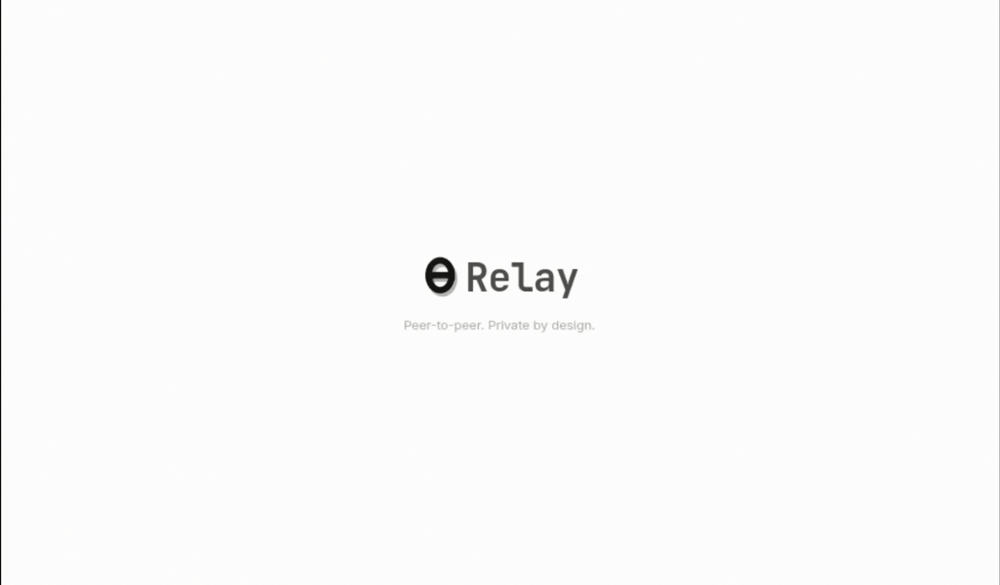
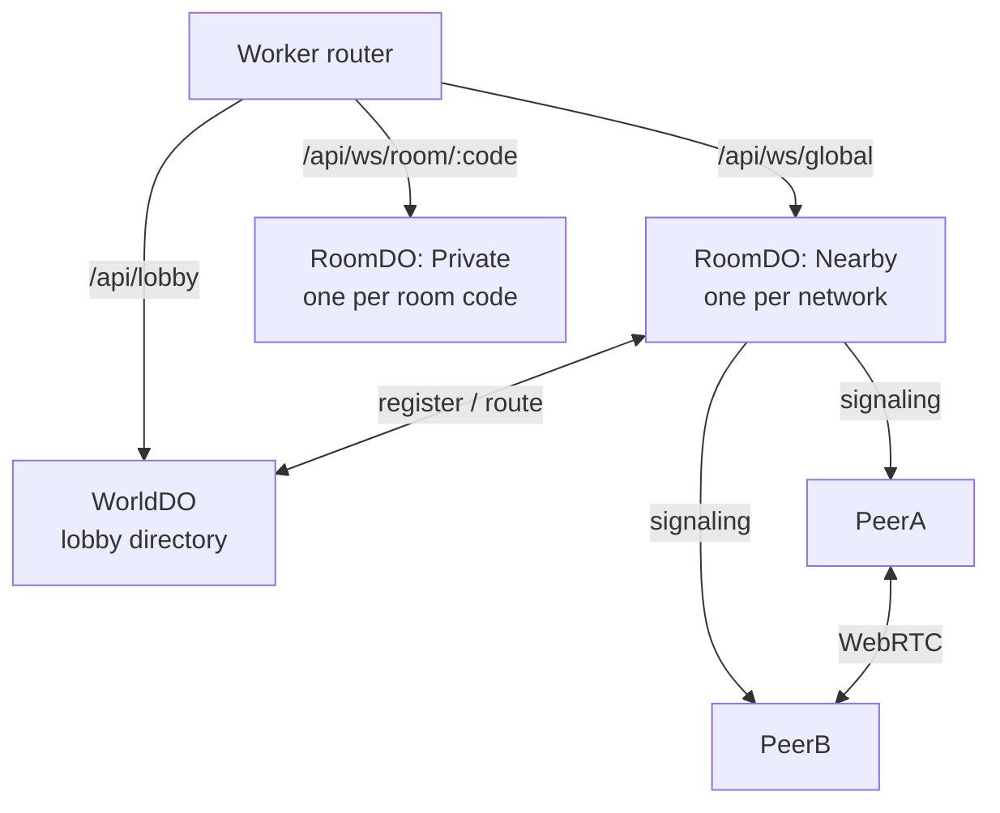

<p align="center">
  
</p>


<h1 align="center">ZeroRelay</h1>

> **ZeroRelay** is a peer-to-peer opensource mesh app for sharing text, code, notes, and files directly between browsers. **No servers store your data** - the signaling server only helps peers discover each other. Everything flows directly between browsers over WebRTC.

<br/>

## Features

| | |
|---|---|
| **Global room, scoped to your network** | Open the app and you're in a room with every device on the same WiFi/router - strangers on other networks never land in it |
| **Everyone lobby** | Find people on other networks (Everyone), invite them, and share directly once they accept. Opt out in your profile |
| **Private rooms** | Create a room, share its code; optional password, only the creator can delete it, auto-expires after 24 h empty |
| **P2P Mesh** | Peers connect directly to each other over WebRTC. Big rooms link on demand, and links keep working through signaling outages |
| **Share Any Type** | Chat, code (monospace), notes (italic), Markdown, or files of any size |
| **Phone-friendly transfers** | Big files stream straight to disk instead of RAM, with progress on both sides, speed, cancel, and clear errors (no space, sender offline, file gone) |
| **Retention Model** | Per-item: session, 5min, 1h, 1d, or forever. See and manage what's stored on your device from your profile |
| **Zero Backend DB** | IndexedDB on each peer for persistence - nothing stored on the server |

---

## Privacy model

| Who | What they see |
|---|---|
| **Peers in your room** | Your display name, avatar, and whatever you share with them |
| **People on other networks** | Only your display name in the lobby - and only if you leave "Show me to people on other networks" on. Nothing is sent to you without your acceptance |
| **Signaling server** | Peer ids, display names, which room you're in, and a *salted hash* of your public IP (used to group devices on the same network). Never your messages, files, or avatars |

Shared content never touches the server. It goes browser-to-browser over WebRTC data channels, which are always encrypted (DTLS).

---

## Quick Start

```bash
# 1. Install dependencies
npm install
npm install --prefix workers/signaling

# 2. Start the frontend
npm run dev

# 3. (separate terminal) Start the signaling worker
npm run dev:worker

# 4. Open http://localhost:3000 in two different browsers
#    (or one normal + one private window)
```

> Each browser profile is one identity, so two tabs of the same browser replace each other (the newest wins). Use two browsers, a private window, or a second device.


## Architecture



Each browser stores its own copy of everything in IndexedDB. When you share something, it's sent to connected peers over WebRTC data channels. The signaling server never sees your messages, files, or avatars.

### Known limitations

- "Same network" means "same public IP". Mobile carriers that put many users behind one IP (carrier-grade NAT) can group unrelated people, and a network with both IPv4 and IPv6 can split devices into two groups.
- There is no relay server: some pairs of networks can't connect directly (strict NATs, many mobile carriers, some office networks). The app shows "Couldn't connect directly" and lets you retry. Devices on the same network always connect.

---

## Documentation

- **[ARCHITECTURE.md](ARCHITECTURE.md)** - rooms, identity, signaling protocol, data flow, storage

---

## License
[MIT](LICENSE)
